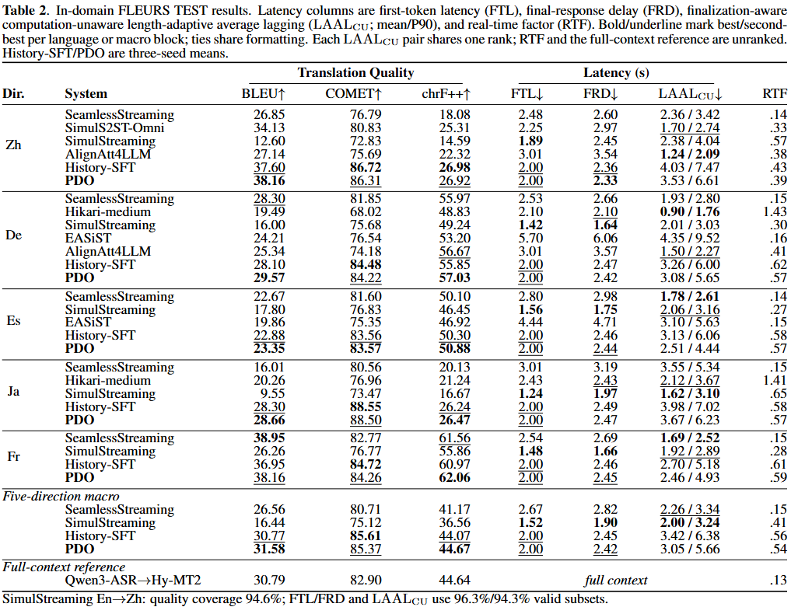

# 面向可修订流式语音翻译的持续交付优化

[English](README.md) | [简体中文](README_zh-CN.md)

本文档介绍论文 [*Persistent Delivery Optimization for Streaming Speech-to-Text Translation with Revisions*](https://arxiv.org/abs/2609.26427) 的官方代码与模型。论文已投稿 **ICASSP 2027**。

[Hugging Face 模型](https://huggingface.co/hf-wzx1205/PDO_S2TT) · [ModelScope 模型](https://modelscope.cn/models/wanzixiang/PDO_S2TT) · [Apache-2.0 许可证](LICENSE)

**直接流式语音翻译 · 面向修订的训练 · 五种目标语言**

PDO 训练流式语音翻译模型尽早输出，并让已经显示的内容尽量保持稳定。模型直接把持续到来的英语语音翻译成可修订的中文、德语、西班牙语、日语或法语，不向用户展示中间转写。

## 从这里开始

| 目标 | 文档 | 内容 |
|:--|:--|:--|
| **运行模型** | [推理与评测](docs/inference.md) | 安装、下载模型、单条 WAV、FLEURS TEST 和完整指标 |
| **训练 PDO** | [训练复现](docs/training.md) | SFT 初始化、四卡训练、断点恢复和 DEV 选择 |
| **对照论文与代码** | [论文公式与实现](docs/paper-to-code.md) | 公式、奖励、采样、损失和 LAAL-CU 的实现位置 |

## 模型权重

模型同时发布在 [Hugging Face](https://huggingface.co/hf-wzx1205/PDO_S2TT) 和 [ModelScope](https://modelscope.cn/models/wanzixiang/PDO_S2TT)。

| 文件 | 用途 | 下载 |
|:--|:--|:--|
| `pdo_s2tt.pt` | 最新五语有限窗口 PDO 模型 | [下载](https://huggingface.co/hf-wzx1205/PDO_S2TT/blob/main/pdo_s2tt.pt) |
| `pdo_s2tt_sft.pt` | 最新五语有限窗口 SFT 初始化模型 | [下载](https://huggingface.co/hf-wzx1205/PDO_S2TT/blob/main/pdo_s2tt_sft.pt) |

两个模型共用一套五语参数。运行时使用 24 秒音频窗口、12 个两秒事件、每次退休 6 个旧事件，并保留最多 128 个可见历史 token。

## 快速推理

建议使用 Linux、Python 3.12、CUDA，以及显存不少于 16 GB 的 GPU。

```bash
git clone https://github.com/ggiggit/PDO_S2TT.git
cd PDO_S2TT

python3.12 -m venv .venv
source .venv/bin/activate
python -m pip install -e .

mkdir -p checkpoints
hf download hf-wzx1205/PDO_S2TT pdo_s2tt.pt --local-dir checkpoints

bash scripts/run_fleurs.sh
```

默认命令会下载官方 FLEURS TEST，并评测全部 647 条英译中样本。英译德、英译西、英译日、英译法以及五语汇总命令已写在 [`scripts/run_fleurs.sh`](scripts/run_fleurs.sh) 中。

## 快速训练

```bash
python scripts/prepare_fleurs_train.py

hf download hf-wzx1205/PDO_S2TT pdo_s2tt_sft.pt --local-dir checkpoints

bash scripts/train_pdo.sh
```

固定训练方案使用 4 张 24 GB GPU，运行 407 轮 rollout 和 1,625 次 AdamW 更新；每轮都会保存推理模型和可恢复的优化器状态。完整训练前请先阅读[训练说明](docs/training.md)。

## 评测结果

最新有限窗口 PDO 模型使用与论文一致的五语 FLEURS TEST：每个方向 647 条，共 3,235 次会话。

| BLEU ↑ | COMET ×100 ↑ | chrF++ ↑ | FRD ↓ | 稳定词 LAAL-CU ↓ | 归一化撤回量 ↓ | RTF ↓ |
|--:|--:|--:|--:|--:|--:|--:|
| 31.2355 | 85.1594 | 44.4709 | 2.2782 秒 | 3.0057 秒 | 0.9211 | 0.3213 |

FRD 和 RTF 会受到硬件与运行环境影响。质量、稳定词 LAAL-CU 和修订指标采用论文中的定义。五个方向的测试均保持有界音频状态。

原论文模型的表 2 保留如下：



## 仓库结构

```text
src/                       模型、流式运行时、PDO 和指标
scripts/                   推理、评测和训练入口
docs/                      推理、训练和论文实现说明
artifacts/reproduction/    轻量训练与评测记录
references/                固定的 FLEURS 样本与训练目标
tests/                     奖励、策略、评测与数据清单测试
```

## 许可证

代码和 PDO 权重使用 [Apache-2.0](LICENSE) 许可证。上游模型和数据集遵循各自的许可证。
